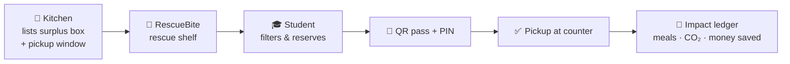
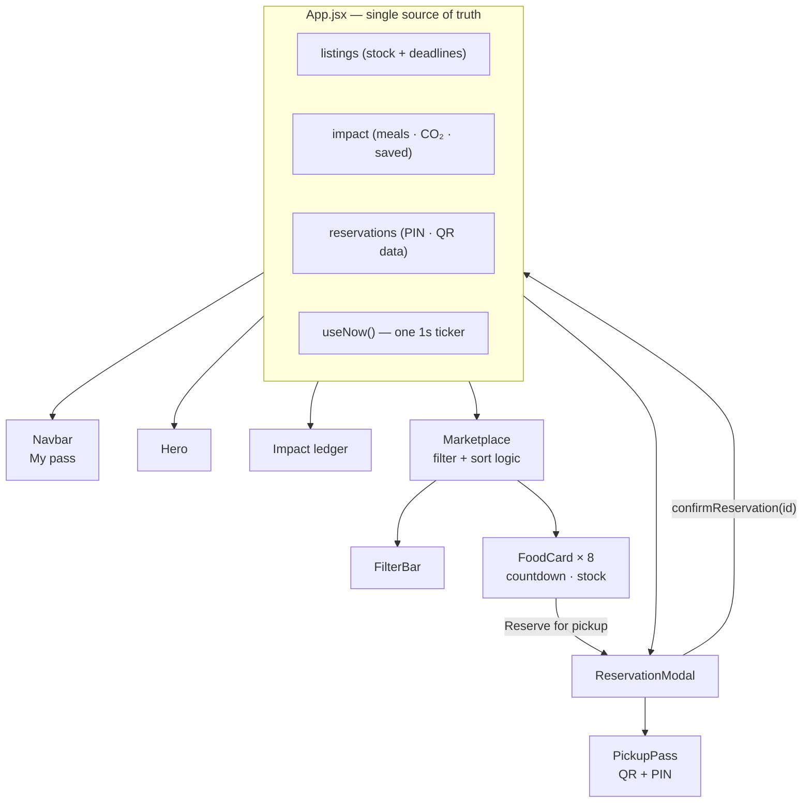
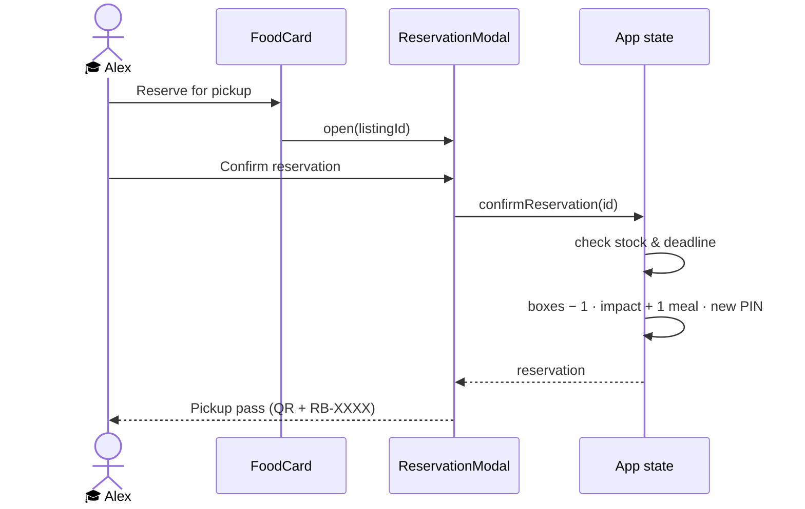

<div align="center">

# 🥐 RescueBite

### Good food deserves a second chance.

**A student food-rescue marketplace.** Campus kitchens list their end-of-day surplus,
students reserve it at rescue prices and collect it with a QR pickup pass —
before it ends up in the bin.

<br />


[**Demo video**](#-demo-video) · [**The problem**](#-the-problem) · [**Our solution**](#-our-solution) · [**60-second judge walkthrough**](#-60-second-judge-walkthrough) · [**Run it locally**](#-run-it-locally)

<br />

<!-- 📸 HERO SCREENSHOT: save a desktop screenshot as docs/screenshots/hero.png -->


</div>

---

## 📌 TL;DR

| | |
|---|---|
| **Problem** | Restaurants and campus cafés throw away good, edible food at closing time, while students struggle with food costs. |
| **Solution** | A marketplace where kitchens list surplus boxes with a pickup window, and students reserve them for a fraction of the price — or free. |
| **What works today** | Browse 8 live listings, filter & sort, live pickup countdowns, reserve a box, get a scannable QR pass + PIN, watch stock and impact numbers update instantly. |
| **Built with** | React 19 · Vite · Tailwind CSS v4 · Lucide icons · `qrcode.react` |
| **My role** | Member 1 — **Student Experience & Marketplace** (the full student-facing frontend). |

---

## 🎬 Demo video

<!--
  HOW TO ADD THE VIDEO (2 minutes):
  1. Record your screen doing the walkthrough below (Windows: Win + Alt + R, or OBS / Clipchamp). Keep it under 2 minutes.
  2. On github.com, open this README and click the ✏️ edit button.
  3. Drag your .mp4 file (under 10 MB on free accounts) into the editor at this spot.
  4. GitHub uploads it and inserts a https://github.com/user-attachments/assets/... link — leave that link on its own line.
  5. Commit. The video now plays right inside the README.
-->

> ▶️ **Video coming soon** — drag the demo `.mp4` here when editing this file on GitHub.

<!-- Optional GIF preview: save as docs/demo.gif -->
<!--  -->

---

## 🌍 The problem

Food waste is one of the largest and most avoidable environmental problems in the world.

- 🗑️ **1.05 billion tonnes** of food were wasted in 2022 — about **one fifth** of all food available to consumers.¹
- 🏪 Around **28%** of that waste comes from food service — restaurants, cafés and canteens.¹
- 🌡️ Food loss and waste generates an estimated **8–10% of global greenhouse-gas emissions**.¹
- 🍽️ Meanwhile, **783 million people** faced hunger in the same period.¹

On a college campus this shows up every single evening:

| Kitchens 🏪 | Students 🎓 |
|---|---|
| Bake and cook for peak demand, so trays of good food are left at closing. | Live on tight budgets and often skip proper meals. |
| Have no fast, simple way to sell what's left. | Have no way to know which nearby kitchen has leftovers *right now*. |
| Lose money and add to landfill. | Pay full price — or go without. |

> **The food exists. The hungry students exist. They're 500 metres apart. Nothing connects them.**

<sub>¹ UNEP, *Food Waste Index Report 2024*.</sub>

---

## 💡 Our solution

**RescueBite connects the two sides in the last hour before closing.**



| For students | For kitchens | For the planet |
|---|---|---|
| Real meals at **60–80% off**, sometimes **free** | Recover cost from food that was going in the bin | Fewer meals in landfill |
| Find food **near campus, right now** | Zero extra work: list it, hand it over | Lower emissions per meal |
| Proof of booking with a **QR pass** | Simple pickup check by PIN or QR | A visible, shared impact score |

---

## ⏱️ 60-second judge walkthrough

> Follow Alex, a student, from hungry to fed. No explanation needed.

| Step | What you do | What you'll see |
|:---:|---|---|
| **1** | Open the site | Editorial hero: *"Good food deserves a second chance."* and the **rescue ledger** (1,420 meals rescued). |
| **2** | Click **Explore the rescue shelf** | Eight surplus listings with photos, prices, dietary tags and **live countdowns**. |
| **3** | Tap **Vegetarian**, **Under $5**, **Nearby · ≤1 km** | The shelf narrows to 2 rescues in real time. |
| **4** | On **Campus Bakery Surprise Bag — $3.50**, click **Reserve for pickup** | A reservation sheet with price, savings, address, instructions and pickup deadline. |
| **5** | Click **Confirm reservation** | A **digital pickup pass**: scannable **QR code**, rescue **PIN** (e.g. `RB-4092`), meal, address and a *Reserved* stamp. |
| **6** | Close the pass | Boxes left drops **4 → 3**, the ledger ticks to **1,421 meals**, and **My pass** in the top bar reopens the pass anytime. |

**Bonus:** reserve the free **Fruit & Yogurt Cup** (only 1 left) to see a listing sell out and its button disable itself.

---

## 📸 Screenshots

<!-- Save screenshots into docs/screenshots/ with these names and they'll appear automatically. -->

| Rescue shelf | Filters in action |
|:---:|:---:|
|  |  |

| Reservation | Pickup pass | Mobile |
|:---:|:---:|:---:|
|  |  |  |

---

## ✨ Features

### 🛒 Marketplace
- **8 realistic surplus listings** — bakery, pizza, salads, halal dinner, vegan wraps, noodles, a free fruit cup and a mezze box.
- Each card shows: **photo**, food & restaurant, **distance from campus**, ~~original price~~, **rescue price** or **FREE**, dietary tags, **live countdown** and **boxes left**.
- **Art-directed grid**: six card layouts (feature, tall, compact, offset, reversed, full-width banner) arranged on a 12-column grid, so the shelf reads like a magazine spread, not a spreadsheet.

### 🔎 Discovery
- **Search** by food, restaurant or category.
- **Filters:** Vegetarian (includes vegan), Vegan, Under $5, Free, Nearby (≤ 1 km) — all combinable.
- **Sorting:** ending soonest · lowest price · closest to campus.
- Live result count, one-tap **Clear all**, and a designed **empty state**.

### ⏳ Live pickup countdowns
- Every listing counts down in `MM:SS`, driven by **one shared timer** for the whole page (no interval per card).
- Under 30 minutes → a quiet **"Last call"** label, no flashing.
- When time runs out or stock hits zero, reservation **disables itself** automatically.

### 🎫 Reservation & pickup pass
- Elegant reservation sheet: price, savings, contents, address, instructions, deadline.
- Generates a **real, scannable QR code** (`qrcode.react`) and a **unique rescue PIN** (`RB-XXXX`, never repeated in a session).
- Inventory and impact statistics update **instantly**.
- Passes are saved in-session and reopen from **My pass**.

### 📊 Impact ledger
- **Meals rescued · kg CO₂e avoided · $ saved by students**, updating live with every reservation.
- Transparent maths: **+1 meal**, **+2.5 kg CO₂e**, **+(menu price − rescue price)** per reservation.

### ♿ Accessibility & quality
- Semantic HTML landmarks, labelled controls, `aria-pressed` filter toggles, `aria-live` result count.
- Modal with **focus trap**, **Esc to close**, scroll lock and focus restore.
- Visible focus states everywhere, colour contrast checked on the palette, `prefers-reduced-motion` respected.
- Images that fail to load fall back to a designed panel — never a broken-image icon.

### 🔒 Honest by design
- Every reservation and pass is clearly labelled **"Demo — not a real booking"**. No payment is taken.
- Impact figures are labelled **sample demo data**.

---

## 🎨 Design system

> Inspired by independent food magazines and café branding — warm, editorial, image-led. Deliberately **not** a generic dashboard or delivery-app clone.

| Token | Colour | Used for |
|---|---|---|
| Forest |  | Primary actions, headings |
| Ivory |  | Page background |
| Sage |  | Soft card tints, numerals |
| Tomato |  | Urgency, FREE, accents |
| Butter |  | Price stickers, highlights |
| Charcoal |  | Body text |

**Typography:** *DM Serif Display* for expressive headlines · *DM Sans* for interface text · small uppercase labels for editorial markers (`N°01 — BAKERY`).

**Signature details:** taped paper sticker *"GOOD FOOD. NO WASTE."*, rotated price stickers, catalogue numbers on every listing, a perforated ticket-style pickup pass with a *Reserved* stamp.

---

## 🏗️ Architecture



**Reservation flow**



### Project structure

```
rescuebite/
├── index.html                 # fonts, meta, favicon
├── vite.config.js
├── src/
│   ├── App.jsx                # state: listings, impact, reservations, modal
│   ├── index.css              # Tailwind v4 theme tokens, keyframes, textures
│   ├── data/
│   │   └── listings.js        # 8 sample listings + initial impact (swap for API)
│   ├── hooks/
│   │   └── useNow.js          # shared ticker: setInterval + cleanup
│   ├── lib/
│   │   └── format.js          # money, countdown, distance, % off
│   └── components/
│       ├── Navbar.jsx         # logo, links, My pass
│       ├── Hero.jsx           # headline, photo composition, sticker
│       ├── CategoryStrip.jsx
│       ├── Impact.jsx         # live rescue ledger
│       ├── Marketplace.jsx    # filter + sort logic, grid
│       ├── FilterBar.jsx      # search, toggles, sort
│       ├── FoodCard.jsx       # 6 layout variants, countdown, stock
│       ├── Photo.jsx          # image + designed fallback
│       ├── ReservationModal.jsx
│       ├── PickupPass.jsx     # QR code + PIN ticket
│       ├── HowItWorks.jsx
│       └── Footer.jsx
└── docs/
    └── screenshots/           # README images
```

---

## 🚀 Run it locally

**Requirements:** [Node.js 22 LTS](https://nodejs.org/) (Vite needs a recent Node version).

```bash
git clone https://github.com/YOUR-USERNAME/rescuebite.git
cd rescuebite
npm install
npm run dev
```

Open **http://localhost:5173**.

| Command | What it does |
|---|---|
| `npm run dev` | Start the dev server with hot reload |
| `npm run build` | Production build → `dist/` |
| `npm run preview` | Serve the production build locally |
| `npm run build:preview` | Build one self-contained HTML file → `dist-preview/` |
| `npm run dev -- --host` | Open the site on your phone over the same Wi-Fi |

---

## ✅ Tested

| Check | Result |
|---|---|
| Dev server starts | ✅ |
| Production build | ✅ |
| Search, all 5 filters, combined filters | ✅ |
| Sort by deadline, price, distance | ✅ |
| Countdowns tick every second | ✅ |
| Reservation → QR + unique PIN | ✅ |
| Stock decrements, sold-out disables button | ✅ |
| Impact ledger updates | ✅ |
| Reopen pass from **My pass** | ✅ |
| Mobile (390 px) — no horizontal scroll | ✅ |
| Console errors | ✅ none |

---

## 🔌 Backend integration (for the team)

The frontend runs on local demo state today and is built so the backend plugs in at **two points**.

**1. Listings** — replace `LISTINGS` in `src/data/listings.js` with an API call:

```http
GET /api/listings
```
```json
[
  {
    "id": "campus-bakery",
    "name": "Campus Bakery Surprise Bag",
    "restaurant": "Crumb & Co. Bakery",
    "category": "Bakery",
    "distanceKm": 0.3,
    "originalPrice": 12,
    "price": 3.5,
    "tags": ["Vegetarian"],
    "boxes": 4,
    "deadline": "2026-10-27T21:40:00+05:30",
    "image": "https://…",
    "address": "12 North Gate Road",
    "instructions": "Show your pass at the till marked Rescue."
  }
]
```

**2. Reservations** — replace the body of `confirmReservation()` in `src/App.jsx`:

```http
POST /api/reservations      { "listingId": "campus-bakery" }
→ 201  { "id": "…", "pin": "RB-4092", "qr": "…", "createdAt": "…" }
→ 409  { "error": "SOLD_OUT" | "PICKUP_CLOSED" }
```

The modal already shows a friendly error if a box sells out between opening and confirming.

---

## 🗺️ Roadmap

- [x] Student marketplace, filters, countdowns, reservation, QR pass *(this repo)*
- [ ] Real backend: listings, reservations, atomic stock
- [ ] Kitchen dashboard: post surplus in 30 seconds, scan QR to verify pickup
- [ ] Student accounts and reservation history
- [ ] Push notifications: "Your favourite bakery just listed a surprise bag"
- [ ] Map view of nearby rescues
- [ ] Payments (UPI / cards) for paid boxes
- [ ] Verified impact reporting per kitchen and per campus

---

## 👥 Team

| Member | Role |
|---|---|
| **Santoshi Kumbhar** | Member 1 — Student Experience & Marketplace (frontend) |
| *Teammate* | *Role* |
| *Teammate* | *Role* |
| *Teammate* | *Role* |

---

## 🙏 Credits

- Food photography from [Unsplash](https://unsplash.com).
- Icons by [Lucide](https://lucide.dev).
- Fonts: [DM Serif Display](https://fonts.google.com/specimen/DM+Serif+Display) and [DM Sans](https://fonts.google.com/specimen/DM+Sans).
- Food-waste figures: UNEP, *Food Waste Index Report 2024*.

<div align="center">
<br />

**Less waste, more taste.** 🌱

<sub>Hackathon prototype. Listings, prices and impact numbers are sample data, and reservations are simulated in the browser.</sub>

</div>
